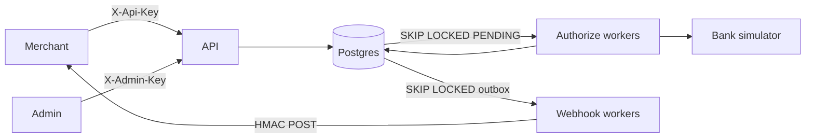
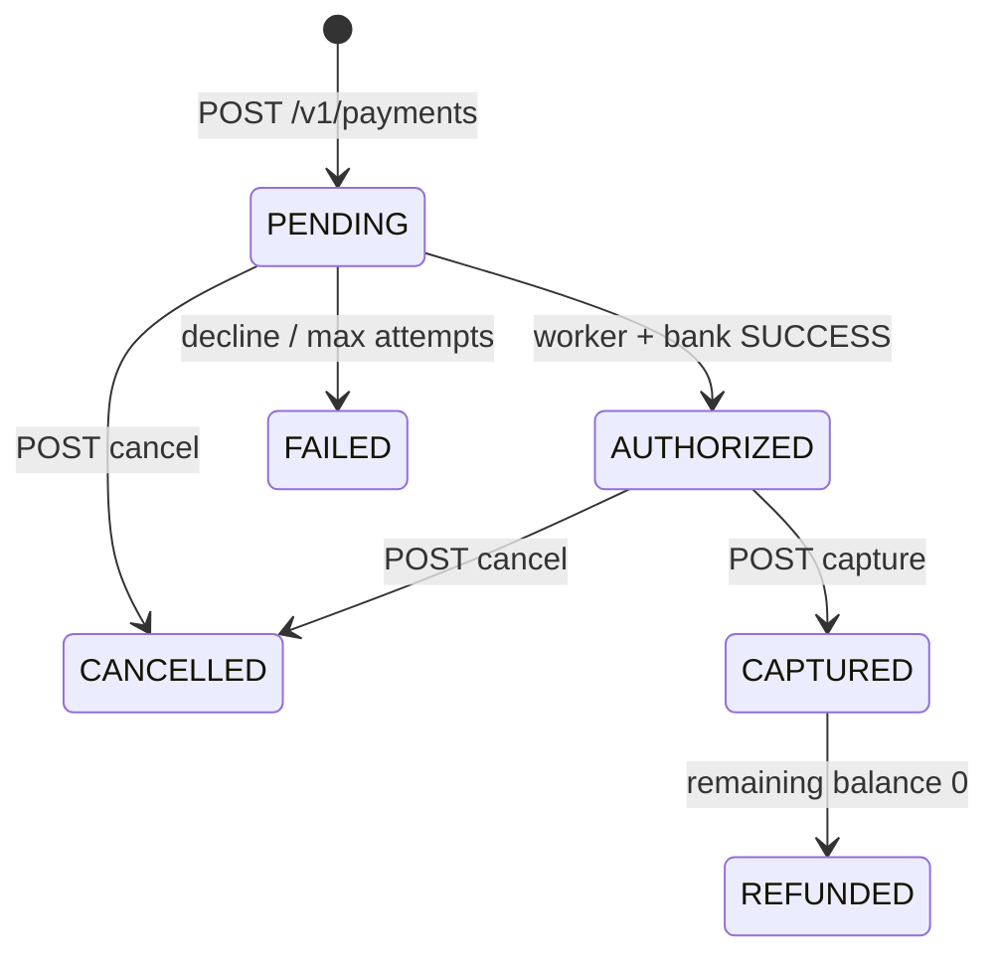
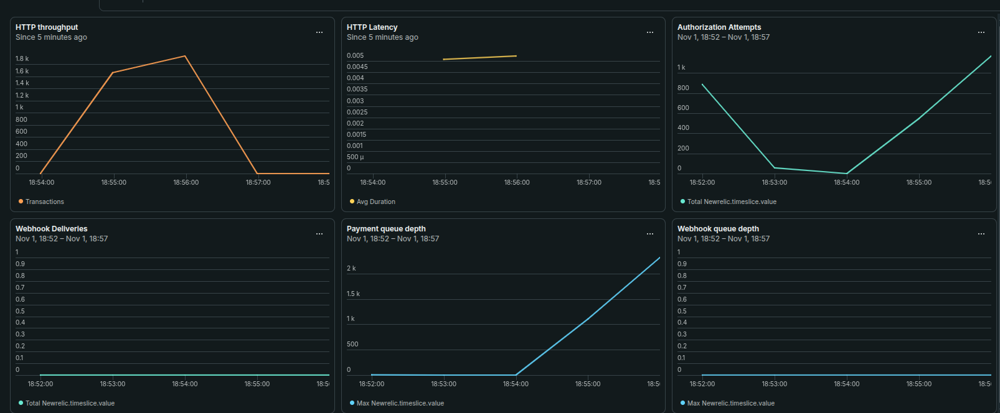

# go-payment-simulator

[](https://github.com/ariwalapratham/go-payment-simulator/actions/workflows/ci.yml)

Go/Gin/Postgres payment gateway simulator: idempotent create, async authorize, capture/cancel/refund, HMAC webhooks. No real money.

## Run

```bash
cp .env.example .env
docker compose -f deployments/docker-compose.yaml up --build
```

API: `http://localhost:8080` · Postgres: `localhost:5434` · migrations run on API start.

```bash
curl localhost:8080/healthz
curl localhost:8080/readyz
```

Auth: `X-Api-Key` (merchant) · `X-Admin-Key` (admin, `PAYMENTS_ADMIN_API_KEY`) · `Idempotency-Key` on creates and refunds.

Host-dev (Postgres in Docker, API on the machine): `docker compose -f deployments/docker-compose.yaml up postgres -d` then `go run ./cmd/api` with `PAYMENTS_DATABASE_PORT=5434`.

## Architecture





**Postgres is the queue.** Authorize and webhook workers `SELECT … FOR UPDATE SKIP LOCKED` due `PENDING` rows. No Redis. One database is the source of truth for payments, idempotency, and delivery.

**Outbox.** Authorize, capture, and refund enqueue `webhook_deliveries` in the **same transaction** as the status change (only if the merchant has `webhook_url`). Workers POST `{id,type,created_at,data}` with `X-Webhook-Timestamp`, `X-Webhook-Signature` = HMAC-SHA256(secret, `timestamp + "." + body`), and a stable `X-Webhook-Event-Id` on retry.

**bigint inside, UUID outside.** Tables use `bigint` PKs; the API exposes `public_id` UUIDs. List cursors are opaque base64 of the internal id.

**Authorize is async.** `POST /v1/payments` inserts `PENDING` and returns. Workers call `bank.Gateway` (in-process simulator). The simulator commits the outcome before sleeping so retries stay idempotent on `PaymentPublicID`. Default mix is 90/5/3/2 success/decline/timeout/failure. 

**Idempotency** is unique on `(merchant_id, scope, key)` plus a request hash. Same key + body replays `200`; same key + different body is `422`.

## Load test

Laptop run: linux/amd64, 12 CPUs, 15.3 GiB. One API process, `db_pool=25`, `worker_pool=4`, pinned bank **100% success / 200ms**. Merchant had **no** `webhook_url`.

| Run | Rate | Duration | HTTP p95 | Authorize p95 | Queue | Drain |
|-----|------|----------|----------|---------------|-------|-------|
| Unique-key create | 15/s | 2m | 9ms | 398ms | 1 | 206ms |
| Unique-key create | 60/s | 1m | 8ms | 2m 0s | 2428 | 2m 6s |
| Shared-key create (20 keys) | 15/s | 2m | 8ms | 365ms | 0 | 6ms |
| Capture + refund (10 × 8) | — | — | — | — | — | — |

Create HTTP stays ~6–9ms in both create runs. Overload latency is **queue wait**, not Gin. Workers cap at ~20/s with a 200ms bank.

New Relic during the 60 RPS run (`Custom/Payments/Queue` climbs; HTTP latency stays ~6ms; webhooks unused):



Reproduce (API already up, pinned bank, merchant with `API_KEY`, no webhook):

```bash
task loadtest:create API_KEY="$API_KEY" RATE=15 DURATION=2m
task loadtest:create API_KEY="$API_KEY" RATE=60 DURATION=1m   # wait for drain
task loadtest:storm  API_KEY="$API_KEY" RATE=15 DURATION=2m
task loadtest:refund API_KEY="$API_KEY"
```

`DURATION` is only the HTTP phase. The process waits until due `PENDING` rows drain, then runs SQL checks.

## Tests

Needs Go 1.27. Integration tests need Postgres on `localhost:5434`.

```bash
task test:unit
task test:integration
task check          # vet + race tests
```

Unit tests live under `tests/unit/`. Integration tests are `//go:build integration` under `tests/integration/`.

## Limitations

- **No ledger.** Balance is payment amount minus sum of `SUCCEEDED` refunds.
- **Webhook order is not guaranteed per payment.** Workers lease globally by `next_attempt_at`; a retry can deliver a later event first. Redelivery keeps the same `X-Webhook-Event-Id`.
- `webhook_secret` **is stored in plaintext** (`merchants.webhook_secret`). API keys are stored as hashes only.
- **Capture and refund do not call the bank.** Only the authorize worker uses `bank.Gateway`. Capture/cancel/refund are local state + outbox.
